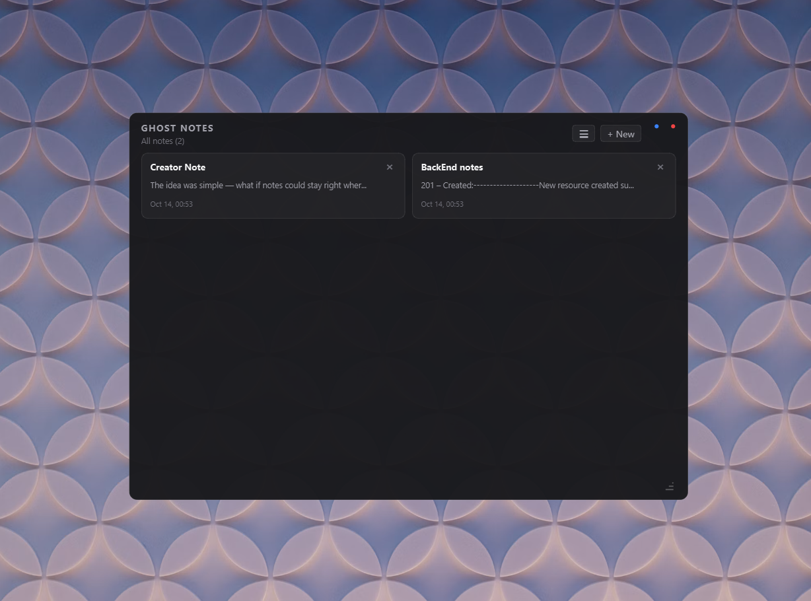
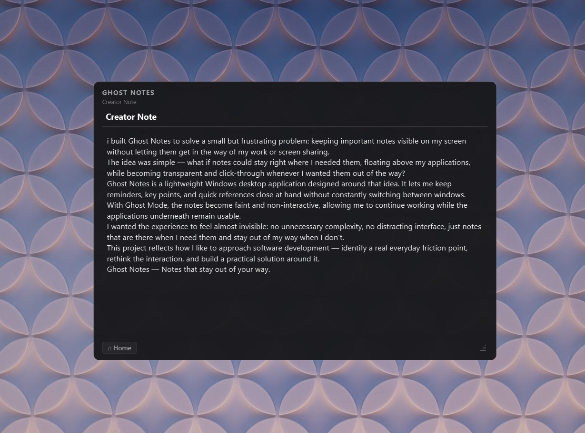
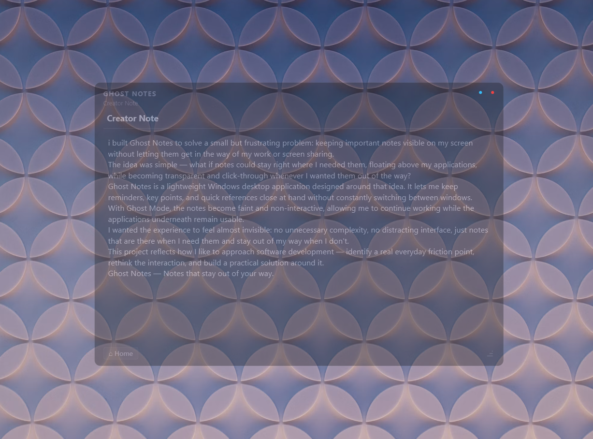
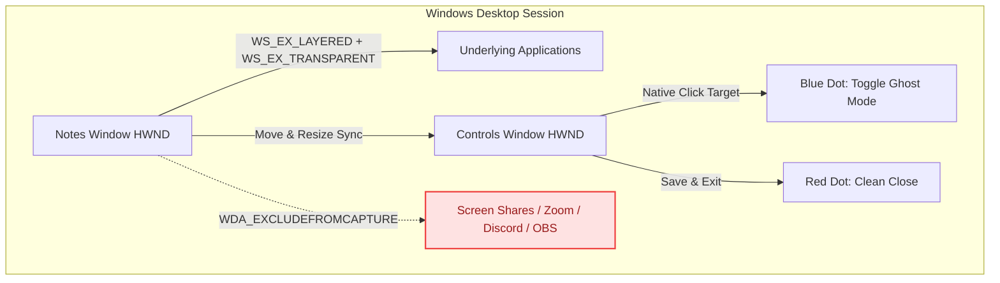

<div align="center">

# 👻 GhostNotes
### The Stealth, Always-on-Top Floating Scratchpad for Windows & macOS

*Invisible to Screen Shares • Click-Through Ghost Mode • Zero Desktop Footprint*

<br/>

[](LICENSE)
[](https://github.com/Anoop-Kumar-31/Ghost-Notes)
[](https://www.python.org/)
[](https://www.qt.io/qt-for-python)
[](tests/)

<br/>


<p align="center">
  
</p>

<br />

<table>
  <tr>
    <td width="45%" align="center">
      
      <br />
      <strong>Visible Note</strong>
    </td>
    <td width="45%" align="center">
      
      <br />
      <strong>Invisible Note</strong>
    </td>
  </tr>
</table>


</div>

---

## 💡 What is GhostNotes?

When working across multiple windows, codebases, or presentations, switching back and forth destroys focus. **GhostNotes** floats quietly above your active windows like a digital heads-up display:

- **Keep notes in plain sight** while working, gaming, browsing, or presenting.
- **Switch to Ghost Mode** to make the notes semi-transparent (35% opacity) and click straight through them into the windows underneath.
- **Total Screen Share Invisibility**: GhostNotes is completely invisible to Zoom, Discord, Google Meet, Teams, OBS, and screenshot grabbers. Only your physical monitor displays your notes.

---

## ⚡ Mode Comparison Matrix

| Feature | 📝 Normal Mode | 👻 Ghost Mode (Click-Through) |
| :--- | :--- | :--- |
| **Window Opacity** | `100%` — Solid dark theme | `35%` — Faded floating overlay |
| **Mouse Interaction** | Select, write, move, resize | Clicks & scrolls pass straight through to windows below |
| **Keyboard Input** | Full typing & editing | Read-only protection (no accidental typing) |
| **Screen Capture** | 🚫 **Invisible** (Hidden from recordings) | 🚫 **Invisible** (Hidden from recordings) |
| **Taskbar & Alt+Tab** | 🚫 **Excluded** (Zero OS clutter) | 🚫 **Excluded** (Zero OS clutter) |
| **Mouse Cursor** | Standard Arrow (`ArrowCursor`) | Natural underlying app cursor passthrough |
| **Controls Access** | `🔵` Blue & `🔴` Red fully interactive | `🔵` Blue & `🔴` Red remain independently clickable |

---

## 🌟 Flagship Features

### 📑 Multiple Notes & Responsive Grid/List Home Page
> *Effortlessly organize thoughts in one lightweight window.*
- **Create & store unlimited notes**: Tap `+ New` to instantly spawn a new note.
- **Dedicated Note Title Line**: An elegant top title line lets you name notes. If left blank, the starting words of the note automatically become the preview title.
- **Bottom-Left Home Button (`[⌂ Home]`)**: Conveniently return to your notes collection via the bottom-left Home button.
- **Responsive Dynamic Grid**: When resizing the window wider, the card grid automatically expands its column count (`2, 3, 4, 5, 6... n × n`) to fit your display width.
- **List vs. Grid View Preference**: Toggle seamlessly between compact List (`☰`) and card Grid (`⊞`) views.

### 👁️ Total Ghost Mode (Screen Share & Screenshot Invisible)
> *Your notes are for your eyes only.*
- Utilizing native Windows Win32 display affinity (`WDA_EXCLUDEFROMCAPTURE`), GhostNotes is **completely invisible to screen recordings, screenshots, and streaming tools**.
- Share your full screen on **Discord, Zoom, Microsoft Teams, Google Meet, OBS, or Slack** without anyone seeing your crib sheet or notes.
- The Windows Snipping Tool and screenshot shortcuts capture right through GhostNotes as if it were not there.

<p align="center">
  
</p>

### 🎯 Not a Shower (Strict Zero-Distraction Cursor)
> *Zero cursor giveaways.*
- **Never changes your mouse cursor**: Hovering over text, buttons, headers, or borders never turns your cursor into an I-beam, text selector, pointing hand, or resize arrow.
- Strictly locks the standard Windows arrow pointer (`Qt.CursorShape.ArrowCursor`) across the entire application interface.
- In Ghost Mode, your cursor passes through seamlessly and respects whatever application is running behind it.

### 🖱️ True Ghost Click-Through
> *Interact directly with what's underneath.*
- Press the **Blue Dot** to activate Ghost Mode: opacity drops to **35%**, and native Win32 extended styles (`WS_EX_LAYERED | WS_EX_TRANSPARENT`) route all clicks, scrolls, and drags to underlying applications.
- Code in your IDE, browse the web, or play games beneath your floating notes without minimizing them.

### 🥷 Phantom Taskbar & Alt+Tab Exclusion
> *Leaves zero desktop clutter.*
- Does not create an icon or tile on the Windows taskbar.
- Completely excluded from the **Alt+Tab** window switcher via native `WS_EX_TOOLWINDOW` extended styles.
- Stays pinned above normal windows without getting in the way of OS navigation.

### 🔴 Minimalist Micro-Controls (Zero Tooltip Overlay)
> *Ultra-clean aesthetic.*
- Two discrete micro-controls aligned horizontally at the top-right corner:
  - `🔵` **Blue Dot (5 × 5 px):** Toggle Ghost Mode (with an 18 × 18 px clickable hit target).
  - `🔴` **Red Dot (5 × 5 px):** Save notes and cleanly exit (with an 18 × 18 px clickable hit target).
- **No hover popups or tooltip overlays**: No text boxes pop up to obscure your screen when moving your mouse nearby.

### 🧩 Independent HWND Dual-Engine
> *Never get trapped in click-through mode.*
- The controls window runs as a separate native Windows window handle (`HWND`) from the notes window.
- Even when the notes window is 100% click-through, the Blue Dot remains independently interactive so you can exit Ghost Mode with a single click.

### 💾 Atomic Persistence & Multi-Monitor Recovery
> *Never lose a single character.*
- Automatically saves notes and window coordinates (debounced 500ms) to `%LOCALAPPDATA%\GhostNotes\notes.json`.
- Uses atomic file replacement (`os.replace`) to protect against corruption during unexpected shutdowns.
- **Multi-Monitor Display Recovery**: If an external monitor is disconnected, GhostNotes automatically repositions back onto your active primary display.

---

## ⌨️ Keyboard Shortcuts

| Shortcut | Description |
| :--- | :--- |
| <kbd>Ctrl</kbd> + <kbd>S</kbd> | Save notes and window geometry immediately |
| <kbd>Ctrl</kbd> + <kbd>Shift</kbd> + <kbd>N</kbd> | Clear notes editor (prompts for confirmation) |
| <kbd>Esc</kbd> | Hide the notes and controls overlay |

---

## 🏗️ Architecture Overview



---

## 🚀 Quick Start Guide

### System Requirements
- **OS:** Windows 10 or Windows 11 (64-bit)
- **Python:** Python 3.11+

### 1. Clone & Setup

```powershell
# Clone the repository
git clone https://github.com/Anoop-Kumar-31/Ghost-Notes.git
cd Ghost-Notes

# Create & activate a virtual environment
py -3 -m venv .venv
.\.venv\Scripts\Activate.ps1

# Install dependencies
pip install -r requirements.txt
```

### 2. Launch GhostNotes

> [!TIP]
> **Zero-Console Silent Launch:** Double-click **`GhostNotes.vbs`** in File Explorer to run GhostNotes silently in the background with `pythonw.exe` without opening a terminal window.

Or launch via terminal:
```powershell
python main.py
```

### 3. Run Automated Tests

```powershell
python -m pytest -v
```

All 13 automated tests validate persistence, corrupted JSON recovery, strict arrow cursor preservation, dual-HWND separation, native Win32 click-through styles, and taskbar exclusion.

---

## 📦 Packaging & Standalone Execution

### No Need to Build? Use `GhostNotes.vbs`!
If you don't want to compile an `.exe`, simply use **`GhostNotes.vbs`**. It launches GhostNotes instantly with no terminal window, giving you the exact same clean desktop experience as an executable with zero setup.

### Optional: Standalone Single-File `.exe` (PyInstaller)
To package GhostNotes into a portable `.exe` that runs on machines without Python:

```powershell
pip install pyinstaller
pyinstaller --noconsole --name "GhostNotes" --clean main.py
```

The resulting executable will be generated at `dist/GhostNotes.exe`.

---

## 📂 Project Structure

```
ghost-notes/
├── .editorconfig          # Code style and indentation rules
├── .gitattributes         # Git LF/CRLF normalization
├── .gitignore             # Git ignore rules (caches, builds, venv)
├── GhostNotes.vbs         # Silent background launcher (no console window)
├── LICENSE                # Apache License 2.0
├── README.md              # Documentation
├── requirements.txt       # Dependencies (PySide6, pytest)
├── main.py                # Main application entry point
├── images/                # Screenshots and UI previews
│   ├── InvisibleNote.png  # Screen capture exclusion demo
│   ├── NotesHome.png      # Home notes grid preview
│   └── VisibleNote.png    # Note editor detail preview
├── ghost_notes/           # Core application package
│   ├── __init__.py
│   ├── controls.py        # Independent Blue/Red control window
│   ├── main_window.py     # Main floating notes window & UI
│   ├── persistence.py     # Atomic JSON load/save & screen geometry recovery
│   ├── platform_utils.py  # Cross-platform dispatcher (macOS Cocoa / Windows Win32)
│   ├── macos_utils.py     # macOS Cocoa ctypes bindings (NSWindow sharing, mouse ignore)
│   └── win32_utils.py     # Windows Win32 ctypes API (WS_EX styles, capture affinity)
└── tests/                 # Automated test suite (17 passing tests)
    ├── __init__.py
    ├── conftest.py        # Shared pytest fixtures
    ├── test_macos.py      # macOS contract & platform dispatch tests
    ├── test_persistence.py# Persistence, atomic writes, corrupted JSON recovery
    ├── test_ui.py         # UI dimensions, cursors, HWND separation
    └── test_win32.py      # Win32 click-through, capture exclusion, taskbar styles
```

---

## 📄 License

This project is licensed under the [Apache License 2.0](LICENSE).
